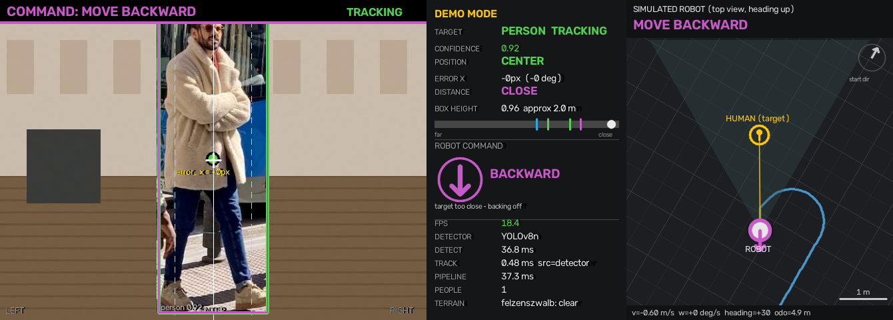

# Autonomous Computer-Vision-Based Human-Following Robot

A real-time, camera-only human-following system. A pretrained deep-learning
detector finds people in the webcam feed. The system picks one person, tracks
them, works out whether they are left, centred or right and whether they are
far, at the ideal distance or too close, and turns that into robot motion
commands. A 2-D robot simulator executes those same commands.

> **Scope.** This prototype does **not** drive a physical robot. It produces the
> navigation commands (`FORWARD`, `BACKWARD`, `LEFT`, `RIGHT`, `LEFT + FORWARD`,
> `RIGHT + FORWARD`, `STOP`) and runs them on a simulated differential-drive
> robot. The laptop webcam does not move, so the simulator shows what a robot
> would be told to do. It is not a closed physical control loop. Hardware can be
> added by sending the same commands to motor drivers (see *Future improvements*).

---

## 1. Problem statement

Build a robot that autonomously follows a chosen person using **only a single
RGB camera** (no LiDAR, no depth camera, no Bluetooth beacon). The robot must:

* detect people in real time,
* choose and keep one target, even when other people are present,
* estimate where the target is horizontally and roughly how far away,
* decide how to move,
* stop safely whenever it is unsure.

## 2. Motivation

Person-following robots are used for luggage, shopping and golf carts, for
warehouse and hospital trolleys, and as assistive devices. Cameras are cheap and
carry a lot of information, but turning pixels into safe motion is hard. The
detections are noisy, people get occluded, several people may be in view, and
a single camera cannot measure depth directly. This project shows a complete,
explainable pipeline that deals with each of these problems on an ordinary laptop.

Our reference paper (Gupta & Gloria, *Golf Bag Carrier Robot Computer Vision*,
Stanford) tackles the same problem for a golf caddy. It used a pretrained
**MobileNet-SSD** to detect and track the golfer, and it explored **K-Means**,
**Felzenszwalb** segmentation and a **convolution + softmax** classifier for
terrain. We adapt that architecture to general human following
(see §15 for the mapping).

## 3. System architecture

```
 WEBCAM / video file                                     utils/video_source.py
    │  BGR frame 640x480
    ▼
 PERSON DETECTION  (ML: YOLOv8n or MobileNetV3-SSDLite)  detection/person_detector.py
    │  [box, confidence, class=person] x N
    ▼
 TARGET SELECTION  (gating, IoU, colour re-ID)           detection/target_selector.py
    ▼
 TARGET TRACKING   (Kalman filter + state machine)       tracking/tracker.py, tracking/kalman.py
    │  smoothed box, track state, confidence
    ├──────────────► POSITION ESTIMATION  LEFT/CENTER/RIGHT     navigation/position_estimator.py
    ├──────────────► DISTANCE ESTIMATION  FAR/IDEAL/CLOSE        navigation/distance_estimator.py
    └──────────────► TERRAIN ANALYSIS (optional, experimental)   segmentation/*.py
    ▼
 DECISION ENGINE   (priority rules + debouncing)         navigation/decision_engine.py
    │  RobotCommand
    ├──────────────► ROBOT SIMULATOR (2-D kinematics)    simulation/robot_simulator.py
    └──────────────► DASHBOARD (camera overlay + panel)  visualization/dashboard.py
```

`pipeline.py` wires the per-frame steps together. `main.py` adds the camera,
the GUI, the keyboard controls, logging and error handling. The tests and
benchmarks call the **same** `FollowerPipeline` class, so what we test is what
runs in the demo.

### Project layout

```
main.py                    entry point (CLI, main loop, safety handling)
pipeline.py                one-frame perception -> decision pipeline
config.py                  ALL tunable parameters
requirements.txt
detection/                 person_detector.py, target_selector.py
tracking/                  tracker.py, kalman.py
navigation/                position_estimator.py, distance_estimator.py, decision_engine.py
segmentation/              kmeans_segmentation.py, felzenszwalb_segmentation.py,
                           common.py (shared traversability logic), terrain_analyzer.py
simulation/                robot_simulator.py
visualization/             dashboard.py
utils/                     smoothing.py, geometry.py, video_source.py, run_logger.py
models/                    yolov8n.pt, ssdlite320_mobilenet_v3_large_coco-*.pth
data/                      collect_data.py, README.md, samples/ (synthetic test video + GT)
tools/                     make_test_video.py, evaluate_synthetic.py, benchmark.py
docs/                      screenshot, recorded demo video, measured results (results/)
tests/                     unit + integration tests
.vscode/launch.json        one-click run configs for VS Code
```

## 4. Machine-learning approach: where ML is used

| Stage | Technique | Type of ML |
|---|---|---|
| Person detection | **YOLOv8n** CNN (default) or **MobileNetV3-SSDLite** CNN, pretrained on MS-COCO | Supervised deep learning (inference with pretrained weights) |
| Terrain segmentation | **K-Means** clustering of L\*a\*b\* colour + row features | Unsupervised learning (fitted on every analysed frame) |
| Terrain segmentation | **Felzenszwalb–Huttenlocher** graph-based segmentation | Unsupervised graph-based segmentation |
| Tracking | **Kalman filter** (probabilistic state estimation) | Classical estimation |
| Re-identification | HSV colour histogram + Bhattacharyya similarity | Hand-crafted feature matching |
| Decision | Rule-based priority controller with temporal smoothing | Not ML. It is deliberately transparent and safe |

The main learned component is the CNN detector. It turns raw pixels into
"there is a person at this box with confidence *p*". Every later step uses the
box it produces as features: centre, height and colour.
**We did not train or fine-tune the detector.** We use the public pretrained
weights (see §16).

## 5. Computer-vision pipeline (per frame)

1. **Pre-processing.** Grab a 640×480 BGR frame. Each detector resizes and
   normalises it internally (YOLO letterboxes to 320 px by default).
2. **Detection.** The CNN forward pass keeps only the `person` class with
   confidence ≥ `CONFIDENCE_THRESHOLD`. Boxes are clipped to the frame, and
   invalid ones (NaN, inverted, tiny) are discarded.
3. **Target selection and tracking.** Detections are associated with the current
   target, and the Kalman filter is updated.
4. **Feature extraction.** From the box we compute the centre, the horizontal
   error, the bearing and the height ratio.
5. **Classification with hysteresis.** Position → LEFT/CENTER/RIGHT. Distance
   proxy → FAR/IDEAL/CLOSE.
6. **(Optional) terrain analysis.** K-Means or Felzenszwalb on a 96-px-wide copy
   gives a "path blocked?" cue.
7. **Decision.** Priority rules produce a raw command. The debouncer turns it
   into a stable command.
8. **Action and visualisation.** The command goes to the simulator, the
   dashboard draws everything, and the logger records the frame.

## 6. Person detection (`detection/person_detector.py`)

* **Input:** a BGR frame. **Output:** `List[Detection(x1, y1, x2, y2, confidence, class)]`.
* **Default: YOLOv8n.** This is a single-stage, anchor-free detector with about
  3.2 M parameters. It is the smallest YOLOv8 model, which is why it runs in real
  time on a CPU. Its predictions come from a single network pass, so latency is
  low and stable. In our measurements (§19) it took about 27 ms per frame on a
  2-core CPU at 320 px input.
* **Alternative: MobileNetV3-SSDLite (`--detector ssd`).** A MobileNet backbone
  with an SSD head. This is the same detector *family* the reference paper used
  (they used a TensorFlow MobileNet-SSD; we use torchvision's MobileNetV3 version).
  This lets us compare against the paper's approach. It was about 2.6× slower
  than YOLOv8n on our test machine.
* **Why a pretrained detector?** Person detection is already solved well by
  models trained on more than 100k labelled images. Training our own would take
  data and GPU time we do not have, and it would almost certainly be less
  accurate. The interesting engineering in this project is everything *after*
  detection.
* **Fallback:** if one detector cannot load, the other is tried. If neither
  loads, the program exits cleanly and the robot stays stopped.

## 7. Target selection and tracking (`detection/target_selector.py`, `tracking/`)

**Selection rules**

1. With exactly one person and no current target, follow that person.
2. While tracking, a detection is accepted only if it is **consistent with the
   Kalman prediction**. It must have IoU ≥ `MIN_IOU_MATCH` or a centre jump of
   at most `MAX_ASSOCIATION_DIST` × frame diagonal. Among the accepted
   candidates, the best score (IoU + proximity + appearance) wins. A more
   confident stranger is **never** preferred over the tracked person.
3. With no previous target, pick the person closest to the image centre.
4. After a loss, first try to **re-identify** the old target by appearance (an
   HSV histogram of the torso, compared with Bhattacharyya distance). If that
   fails, fall back to rule 3.

**Tracking.** A constant-velocity Kalman filter tracks the state
`[cx, cy, w, h, vx, vy, vw, vh]`. This is the motion model used by SORT. It
smooths jittery boxes and *predicts* the box when the detector misses a frame.

```
SEARCHING ──acquire──► TRACKING ──miss──► COASTING ──re-detected──► TRACKING
                                              │ > LOST_TIMEOUT_FRAMES
                                              ▼
                                            LOST ──re-identified / new person──► TRACKING
```

While COASTING, the confidence is multiplied by `COAST_CONFIDENCE_DECAY` on
every missed frame. Once it drops below `CONFIDENCE_THRESHOLD`, the decision
engine forces **STOP**. In practice the robot keeps its last motion for about 3–5
frames (around 0.1–0.25 s) through a brief miss, and then stops. With
`DETECT_INTERVAL > 1` the detector runs only every N frames. The frames in
between are bridged by an OpenCV CSRT/KCF tracker if `opencv-contrib` is
installed, and by the Kalman prediction otherwise.

We do not use OpenCV's MIL tracker by default. We measured it at about 50 ms
per update, which is slower than YOLOv8n itself.

## 8. Position estimation (`navigation/position_estimator.py`)

```
cx = (x1 + x2) / 2            error_x = cx − frame_width / 2
error_norm = error_x / (frame_width / 2)  ∈ [−1, 1]
bearing ≈ atan(error_norm · tan(HFOV/2))   (display only)
```

The classification uses **hysteresis**. With the default settings it switches
to LEFT when `error_norm < −0.18`, and returns to CENTER only when
`error_norm > −0.12` (`HORIZONTAL_THRESHOLD − HORIZONTAL_HYSTERESIS`).
The error is EMA-smoothed first.

The frames are *not mirrored*, because the camera is the robot's eye. If you
face the laptop and step to **your** right, you appear on the **left** of the
image. The robot should then turn **left** toward you, and it does.

## 9. Distance estimation: a monocular proxy (`navigation/distance_estimator.py`)

A single webcam **cannot measure metric depth**. Under the pinhole model, image
height is proportional to 1/distance, so we use

```
ratio = box_height / frame_height
ratio < TOO_FAR_HEIGHT (0.50)                → FAR
IDEAL_MIN (0.55) ≤ ratio ≤ IDEAL_MAX (0.80)  → IDEAL
ratio > TOO_CLOSE_HEIGHT (0.90)              → CLOSE
(in the gaps the previous zone is kept, which acts as hysteresis)
```

The UI labels this **"DISTANCE: FAR / IDEAL / CLOSE"**. It is a **relative
distance proxy, not calibrated depth**.

The panel also shows a rough figure such as *"approx 3.0 m"*. It comes from the
pinhole formula and assumes a 1.70 m standing person and a 60° horizontal field
of view. It is **not calibrated**: it is wrong for seated people and for
non-standard lenses. When the box touches the top or bottom edge of the frame,
part of the person is cut off, so the figure is shown as an upper bound (`< X m`).

**Calibration:** press **`c`** while standing at the distance you want the robot
to keep. The IDEAL band is re-centred on your current box height. This makes
the demo work in rooms of any size.

## 10. Navigation decision logic (`navigation/decision_engine.py`)

| Priority | Condition | Command |
|---|---|---|
| 1 | target not visible / LOST | **STOP** (immediate) |
| 2 | confidence < threshold | **STOP** (immediate) |
| 3 | CLOSE | **BACKWARD** (or STOP if `BACKWARD_WHEN_CLOSE = False`) |
| 4 | FAR + CENTER / LEFT / RIGHT | **FORWARD** / **LEFT + FORWARD** / **RIGHT + FORWARD** |
| 5 | IDEAL + LEFT / RIGHT | **LEFT** / **RIGHT** (turn in place) |
| 6 | IDEAL + CENTER | **STOP** (holding position) |
| 7 | optional terrain veto: path blocked | remove the forward component |

### Closed-loop turning and laptop motion (`navigation/heading.py`, `tracking/ego_motion.py`)

The webcam cannot turn, so the robot keeps a **virtual heading**. A turn command
moves the robot's aim (the cyan **ROBOT FACING** line on the camera view) toward
the target, and LEFT/CENTER/RIGHT is measured from that line, not from the frame
centre. When the robot faces you the command becomes STOP, just as on a real
robot. The turn speed is proportional to the error, so it does not overshoot.

If someone **rotates the laptop**, the background slides sideways. Lucas-Kanade
optical flow on background corners (people masked out) measures the rotation
(`yaw = atan(-dx / f)`). The laptop *is* the robot, so the robot's heading is
turned by the same angle. You are then off-centre, and the robot turns back to
face you ("LAPTOP TURNED 15 deg LEFT - ROBOT CORRECTING").

Whether *you* are walking left or right is judged from your bearing in the world
(camera bearing + laptop rotation), so turning the laptop is not mistaken for
you moving. The camera faces you, so the robot's left is **your right**. The UI
shows both.

`--open-loop` restores the old behaviour, where the aim stays at the frame centre.
The benchmark and evaluation use it because their ground truth is in camera coordinates.

### Why temporal smoothing is necessary

A detector's box moves by a few pixels every frame even when the person stands
still. Without smoothing, a person standing near a threshold would make the
robot flip LEFT/RIGHT/LEFT many times a second. That is useless and, on real
motors, harmful. We stack three mechanisms (all in `config.py`):

1. **EMA** on the measurements (`SMOOTHING_FACTOR`).
2. **Hysteresis** on the LEFT/CENTER/RIGHT and FAR/IDEAL/CLOSE thresholds.
3. A **command debouncer**. A new command must win `COMMAND_PERSISTENCE_FRAMES`
   consecutive frames, *and* the current command must have been held for
   `MIN_COMMAND_DURATION` seconds.

**Safety STOPs bypass the debouncer.** Stopping is never delayed.

We measured the effect in an ablation (§19). With ±12 px of artificial box
jitter, the robot made **32** command changes without smoothing and **9** with
it, on a scenario that needs about 9.

## 11. K-Means segmentation (`segmentation/kmeans_segmentation.py`)

This follows the paper's *K-Means based filter*. The steps are:

1. Resize to 96 px wide and blur.
2. Convert to **CIE L\*a\*b\*** and add a small row-position feature.
3. Run **K-Means (K = 4)** with `cv2.kmeans`. Each run is warm-started from the
   previous centres, so the clusters stay stable from frame to frame.
4. Select the cluster(s) of interest. These are the clusters covering the
   **ground seed**, the patch directly in front of the robot, which we assume is
   ground the robot is standing on.
5. Like the paper's filter, also accept every segment whose mean colour lies
   within a colour distance (`GROUND_COLOR_TOLERANCE`) of that ground colour.
6. Keep only regions connected to the seed. The target person's box is ignored.

From the result we compute the **free-space depth** in the left, centre and
right corridors: how far up from the bottom the ground stays traversable. If the
centre depth is below `FREE_SPACE_MIN`, the path is flagged **BLOCKED**.

We use L\*a\*b\* rather than RGB because the paper itself notes that K-Means on
raw colour is "not robust to color variations". Lab separates lightness from
colour, and its distances match perceived colour differences better.

## 12. Felzenszwalb segmentation (optional, `segmentation/felzenszwalb_segmentation.py`)

This is the graph-based segmentation from scikit-image. It has the same
interface and uses the same seed and colour-pooling traversability logic. That
corresponds to the paper's *"Felzenszwalb segmentation followed with cluster
pooling"*. It runs every 15 frames by default and is skipped gracefully if
scikit-image is not installed.

**Both segmentation methods are experimental.** They display a debug view. They
only affect motion if you pass `--terrain-veto`. A floor coloured like the wall,
strong shadows, or a webcam that only sees a desk will fool them.

## 13. Robot simulation (`simulation/robot_simulator.py`)

The simulator is a unicycle / differential-drive model:
`v = linear·0.6 m/s`, `ω = angular·50°/s`, `x += v cosθ dt`, `y += v sinθ dt`,
`θ += ω dt`. Each frame, it receives **exactly the debounced command** that the
decision engine produced; nothing is scripted.

The view is a heading-up top view. It shows the robot with a motion arrow, the
camera's field-of-view wedge, a world grid that rotates as the robot turns, the
driven trail, a compass pointing to the start direction, and the **perceived
human**, placed at the estimated bearing and rough distance.

## 14. Dashboard (`visualization/dashboard.py`)

* **Camera view:** the target box (green = TRACKING, amber = COASTING,
  red = LOST), the target centre, a frame-centre cross, the LEFT/CENTER/RIGHT
  threshold lines, the horizontal-error arrow, and a command banner.
* **Panel:** target status, confidence, position, error and bearing, distance
  zone, the distance-proxy bar with all four thresholds, the command with an
  arrow icon and the reason for it, FPS, and the detector name. Debug mode adds
  per-stage latencies and the number of people in view.
* **Command colours:** STOP red, FORWARD green, BACKWARD purple, LEFT blue,
  RIGHT orange.

## 15. Alignment with the reference paper

| Reference paper (golf caddy) | This project (human follower) |
|---|---|
| Camera-only perception | Camera-only perception (laptop webcam) |
| Pretrained TensorFlow **MobileNet-SSD** gives bounding boxes on the golfer | Pretrained **YOLOv8n** (default) **or MobileNetV3-SSDLite** (`--detector ssd`) |
| Bounding-box tracking of the golfer | Kalman tracking, gated association, re-identification, LOST handling |
| **K-Means** + colour-distance filter for traversable terrain | K-Means in L\*a\*b\* + ground-seed + colour-distance filter |
| **Felzenszwalb** + pooling | Felzenszwalb (scikit-image) + seed/colour pooling (optional) |
| Images downscaled (to 112×200) for real time | Segmentation on a 96×72 image, run every N frames |
| Convolution + softmax classifier trained on 11 hand-labelled images | **Not implemented.** It needs hand-labelled pixels, which we do not have (see Future improvements) |
| Navigation and path planning (proposed) | Implemented: rule-based follow controller + simulator |

## 16. Dataset and model information

| | Details |
|---|---|
| **Pretrained models** | YOLOv8n (Ultralytics, AGPL-3.0) and SSDLite320-MobileNetV3-Large (torchvision, BSD-3) |
| **Training dataset of those models** | **MS-COCO 2017** detection: about 118k training and 5k validation images, 80 classes. We only use `person` |
| **What we trained** | **Nothing.** No training or fine-tuning was done. K-Means is fitted, unsupervised, on each analysed frame at run time |
| **Our test data** | (a) live webcam at demo time; (b) a **synthetic** video, `data/samples/test_walk.mp4` (440 frames), with frame-level ground truth, made by `tools/make_test_video.py` from pedestrian crops in Ultralytics' bundled `bus.jpg` |
| **Optional custom data** | `data/collect_data.py` captures your own frames, with optional YOLO-format *pseudo*-labels |

## 17. Installation

Python 3.9–3.12 is recommended (3.13 also works). From the project folder:

```bash
python -m venv .venv
# Windows:      .venv\Scripts\activate
# Linux/macOS:  source .venv/bin/activate
pip install -r requirements.txt
```

**Windows shortcut:** double-click `setup_windows.bat` once, then
`run_demo_windows.bat` every time. The `.venv` folder is per-machine: do not copy
it between computers. Create it fresh on each one.

`ultralytics` also installs PyTorch (CPU build), which is a few hundred MB.
Both model weight files are already in `models/`, so no download is needed at
run time.

## 18. How to run

```bash
python main.py --demo                 # faculty demo: camera + panel + simulated robot
python main.py                        # normal mode: camera + status panel
python main.py --simulate             # normal mode + simulator
python main.py --debug                # debug overlays, latencies, K-Means window
python main.py --segmentation         # K-Means terrain view
python main.py --segmentation felzenszwalb
python main.py --camera 1             # use another webcam
python main.py --detector ssd         # MobileNet-SSD, as in the reference paper
python main.py --detect-interval 2    # run the detector every 2nd frame (faster)
python main.py --terrain-veto         # EXPERIMENTAL: segmentation may block FORWARD
python main.py --log                  # write logs/run_<time>.csv + .json summary
python main.py --open-loop            # robot aim fixed at the frame centre (old behaviour)
python main.py --no-ego               # do not measure laptop rotation
```

**No webcam? Use the fallback test mode:**

```bash
python main.py --demo --source data/samples/test_walk.mp4 --loop
python main.py --source data/samples/test_walk.mp4 --headless --log --open-loop   # no window, prints a summary
python tools/evaluate_synthetic.py                                     # scores the last run vs ground truth
python tools/benchmark.py                                              # compares detectors / settings
python -m unittest discover -s tests -v                                # 47 unit + integration tests
```

In VS Code, open the **Run and Debug** panel and choose *Demo (webcam)*,
*Test video (no webcam)* or *Unit tests*.

## 19. Controls

| Key | Action |
|---|---|
| `q` / `Esc` | quit (the robot is commanded to STOP) |
| `p` | pause / resume (the robot STOPs while paused) |
| `d` | toggle debug overlays |
| `s` | cycle segmentation: off → K-Means → Felzenszwalb |
| `r` | reset the target (re-select a person) |
| `c` | calibrate: stand centred at your preferred distance; the robot faces the camera centre and that distance becomes IDEAL |
| `o` | save a screenshot to `logs/` |
| `h` | show/hide help |

## 20. Expected output and measured results



`docs/demo_synthetic.mp4` is a recording of the full dashboard on the
synthetic test video. Keep it as a backup for the viva in case the webcam
misbehaves. The raw measurement files are in `docs/results/`: the benchmark
JSON, plus the per-frame CSV, summary and evaluation of the reference run.

**Live demo.** When you step left or right, the position changes and the robot
turns. Walk away and it shows `FAR` and `MOVE FORWARD`. Walk up close and it
shows `CLOSE` and `MOVE BACKWARD`. Leave the frame and the status turns amber
(COASTING), then red (`LOST`), and the command becomes `STOP`. Come back and you
are re-identified.

**Measured on the synthetic test video.** These numbers come from
`tools/benchmark.py` and `tools/evaluate_synthetic.py`. They were measured in a
cloud container with a 2-vCPU x86 CPU and no GPU. Your laptop will differ, so
re-run `python tools/benchmark.py` on it.

| Configuration | Pipeline FPS* | Detector ms | Tracked while visible | Mean IoU vs GT | Identity switches | Command changes |
|---|---|---|---|---|---|---|
| YOLOv8n, detect every frame | 36.0 | 26.9 | 100 % | 0.942 | 0 | 9 |
| YOLOv8n, detect every 3rd frame | 94.5 | 26.5 | 100 % | 0.907 | 0 | 9 |
| MobileNetV3-SSDLite (paper family) | 14.2 | 69.4 | 100 % | 0.896 | 0 | 9 |
| YOLOv8n + K-Means (every 5th frame) | 36.8 | 25.2 (seg 5.0 ms) | 100 % | 0.942 | 0 | 9 |
| YOLOv8n + Felzenszwalb (every 15th frame) | 38.5 | 24.7 (seg 7.1 ms) | 100 % | 0.942 | 0 | 9 |
| ±12 px box jitter, smoothing **ON** | 37.6 | 25.7 | 100 % | 0.804 | 0 | **9** |
| ±12 px box jitter, smoothing **OFF** | 38.3 | 25.3 | 100 % | 0.804 | 0 | **32** |

\*Processing only, without camera capture or drawing. The full loop with the
dashboard rendered ran at about 25–36 FPS in the same environment. Tracker
update time was 0.36 ms on average. Position labels agreed with ground-truth
labels on 96.6 % of frames, and distance zones on 99.2 %. The disagreements
are mostly the deliberate lag added by smoothing and hysteresis at transitions.
**The robot never moved while the target was LOST (0 frames).**

These figures test the **software pipeline on synthetic data**. They are not a
measure of real-world detection accuracy.

## 21. Limitations

* **No physical robot.** The commands are simulated, and the static webcam
  means there is no closed-loop feedback.
* **Distance is a relative proxy.** It assumes the person is fully visible and
  standing. Sitting, crouching or partial views change the box height. The
  metric read-out is uncalibrated.
* **Re-identification is colour-based.** Two people in similar clothes can be
  confused after a loss. While the target is continuously tracked, spatial
  gating prevents switches.
* **Segmentation is heuristic and unsupervised.** It assumes the area in front
  of the robot is ground, so it is an experimental cue only.
* A laptop webcam at desk height mostly sees the upper body. Stand back 2–4 m,
  or press `c`, for meaningful FAR/IDEAL/CLOSE behaviour.
* Detector accuracy is limited by YOLOv8n/COCO. Expect poor results in very low
  light, under heavy occlusion or with unusual poses.

## 22. Future improvements

* **Hardware:** send `RobotCommand.motion` (linear, angular) over serial,
  Bluetooth or Wi-Fi to an ESP32/Arduino motor driver, and close the loop with
  wheel odometry.
* **Proportional control** instead of discrete commands: angular velocity ∝
  bearing, linear velocity ∝ (ideal − current) height.
* **Learned re-identification**, such as OSNet embeddings or DeepSORT/ByteTrack,
  for crowded scenes.
* **Monocular depth networks** (e.g. MiDaS / Depth-Anything) or a stereo/ToF
  camera for metric distance and obstacle detection.
* **The paper's convolution + softmax terrain classifier.** This needs
  hand-labelled pixels. `data/collect_data.py` can capture the frames, which can
  then be labelled with CVAT/LabelMe.
* Fine-tune YOLOv8n on footage from the robot's own camera height and viewpoint.

## 23. Team contributions

| Member | Contribution |
|---|---|
| Vrunda C | *(fill in, e.g. detection & tracking, decision engine, testing)* |
| Chiranth R | *(fill in, e.g. segmentation, simulator, documentation)* |

## 24. References

1. A. Gupta, N. Gloria, *Golf Bag Carrier Robot Computer Vision*, Stanford University (course project report). Provided as `12.pdf`.
2. G. Jocher, A. Chaurasia, J. Qiu, *Ultralytics YOLOv8*, 2023. https://github.com/ultralytics/ultralytics
3. W. Liu et al., "SSD: Single Shot MultiBox Detector", ECCV 2016.
4. A. Howard et al., "Searching for MobileNetV3", ICCV 2019.
5. T.-Y. Lin et al., "Microsoft COCO: Common Objects in Context", ECCV 2014.
6. P. F. Felzenszwalb, D. P. Huttenlocher, "Efficient Graph-Based Image Segmentation", IJCV 59, 2004.
7. A. Bewley et al., "Simple Online and Realtime Tracking (SORT)", ICIP 2016.
8. R. E. Kalman, "A New Approach to Linear Filtering and Prediction Problems", J. Basic Eng., 1960.
9. S. Lloyd, "Least squares quantization in PCM" (K-Means), IEEE Trans. Inf. Theory, 1982.
10. R. Manduchi et al., "Obstacle detection and terrain classification for autonomous off-road navigation", Autonomous Robots 18, 2005.
11. OpenCV, https://opencv.org; scikit-image, https://scikit-image.org
